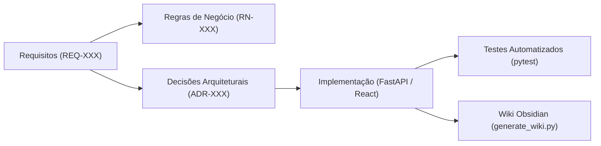

# Levantamento e Evolução de Requisitos — GIPAR

Este documento atua como o painel central de rastreabilidade e governança de requisitos do sistema GIPAR.

---

## 1. Visão Geral e Baseline Histórica

O GIPAR (Gestão Inteligente de Patrimônio e Recursos) teve sua primeira versão documentada pela equipe anterior. Conforme alinhamento de engenharia:
- **Baseline Legada:** O documento original mantido em [`docs/acompanhamentos/Documento de Requisitos.pdf`](file:///c:/Users/Luiz/Documents/BSI/TCC/Projeto/cepedi-capacita04-grupo3/docs/acompanhamentos/Documento%20de%20Requisitos.pdf) permanece intacto como registro histórico de partida.
- **Evolução de Requisitos:** Novas funcionalidades, refatorações, correções críticas e alinhamento de regras de negócio são geridos no padrão atômico `REQ-XXX` nesta pasta.

---

## 2. Matriz de Requisitos do Projeto

| ID | Nome do Requisito | Tipo | Módulo | Status | Requisito Anterior / Origem |
| :--- | :--- | :--- | :--- | :--- | :--- |
| [`REQ-001`](file:///c:/Users/Luiz/Documents/BSI/TCC/Projeto/cepedi-capacita04-grupo3/docs/01-requisitos/requisitos/REQ-001-chatbot-atendimento.md) | Chatbot de Atendimento e Consulta de Patrimônio | Nova funcionalidade | Chatbot / IA | 🟡 Em análise | Nova necessidade |
| [`REQ-002`](file:///c:/Users/Luiz/Documents/BSI/TCC/Projeto/cepedi-capacita04-grupo3/docs/01-requisitos/requisitos/REQ-002-responsividade-mobile.md) | Responsividade Mobile da Interface Web | Melhoria / UX | Frontend | 🟡 Em análise | Diagnóstico de usabilidade |
| [`REQ-003`](file:///c:/Users/Luiz/Documents/BSI/TCC/Projeto/cepedi-capacita04-grupo3/docs/01-requisitos/requisitos/REQ-003-gestao-usuarios-temas.md) | Gestão Avançada de Usuários, Perfil e Temas | Melhoria / Correção | Usuários / Perfil | 🟡 Em análise | Backlog de melhorias |
| [`REQ-004`](file:///c:/Users/Luiz/Documents/BSI/TCC/Projeto/cepedi-capacita04-grupo3/docs/01-requisitos/requisitos/REQ-004-filtros-pesquisa-listagens.md) | Filtros de Pesquisa Dinâmicos nas Listagens | Melhoria / Usabilidade | Frontend / Listas | 🟡 Em análise | Backlog de usabilidade |

---

## 3. Legenda de Status

- 🟡 **Em análise:** Requisito documentado, aguardando validação final de regras de negócio.
- 🟢 **Aprovado:** Requisito e critérios de aceitação validados com os interessados.
- 🔵 **Em implementação:** Em desenvolvimento técnico nas branches do projeto.
- 🟣 **Concluído:** Implementado, testado e com documentação sincronizada no Obsidian.

---

## 4. Rastreabilidade com Arquitetura e Decisões

