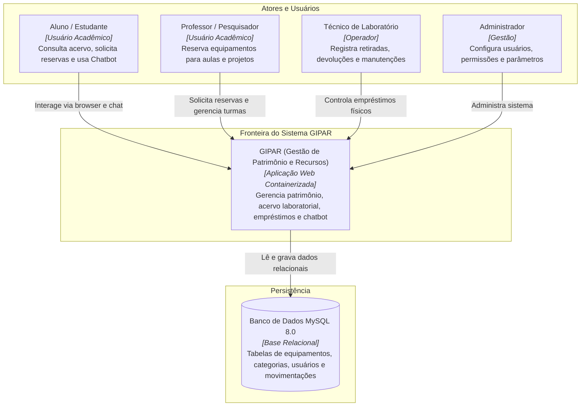
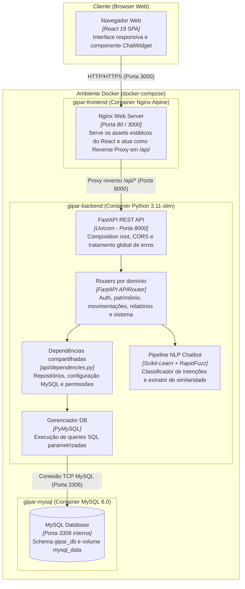

# Diagramas de Arquitetura — Modelo C4: GIPAR

Este documento documenta os níveis 1 (Contexto) e 2 (Contêineres) da arquitetura do GIPAR com base no modelo C4, renderizado em Mermaid.js.

---

## 1. C4 Model — Nível 1: Contexto do Sistema

Ilustra os usuários do sistema, as fronteiras da aplicação GIPAR e seus limites externos.

---

## 2. C4 Model — Nível 2: Contêineres da Aplicação

Detalhamento dos contêineres Docker, tecnologias em execução e portas de comunicação.

---

## 3. Rastreabilidade
- **Requisitos:** `REQ-001`, `REQ-002`, `REQ-003`, `REQ-004`
- **ADRs:** `ADR-001`, `ADR-002`, `ADR-004`
