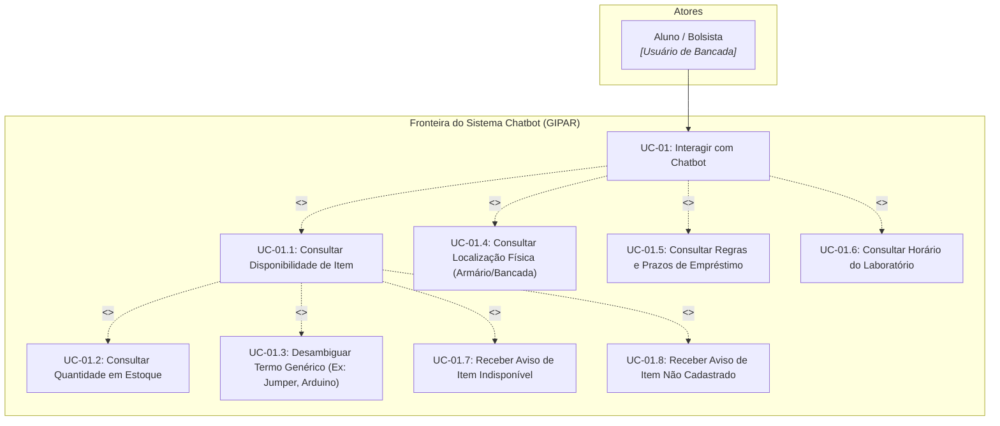

# Diagrama de Casos de Uso — UC-01: Atendimento e Consulta via Chatbot

Este documento detalha o caso de uso **UC-01 (Atendimento e Consulta via Chatbot)** a partir da perspectiva do usuário principal (Aluno / Bolsista de Laboratório), mapeando os fluxos funcionais, relações de inclusão e extensão.

---

## 1. Visão Geral do Caso de Uso

- **Ator Primário:** Aluno de Graduação / Pós-graduação e Bolsista de Laboratório.
- **Ator Secundário (Opcional):** Técnico de Laboratório (para consultas rápidas de bancada).
- **Objetivo:** Obter informações instantâneas sobre disponibilidade de componentes, localização em armários, horários e normas de empréstimo sem intervenção manual imediata do técnico.

---

## 2. Diagrama de Casos de Uso UML (Mermaid)

---

## 3. Especificação dos Subcasos de Uso

| Caso de Uso | Descrição | Regra de Negócio | Gatilho / Exemplo |
| :--- | :--- | :--- | :--- |
| **UC-01.1** | Consulta se determinado item existe e está livre para uso. | `RN-008`, `RN-009` | *"Tem Arduino Mega disponível?"* |
| **UC-01.2** | Informa a quantidade exata disponível para montagens. | `RN-009` | *"Quantos jumpers macho x macho temos?"* |
| **UC-01.3** | Lista opções com contagens quando a pergunta for genérica. | `RN-008` | *"Tem jumper?"* $\to$ Lista 3 modelos e quantidades. |
| **UC-01.4** | Informa em qual armário, gaveta ou bancada o item fica. | `RN-003`, `RN-009` | *"Onde fica a estação de solda?"* |
| **UC-01.5** | Esclarece regras de retirada, prazos e penalidades. | `RN-011` | *"Posso levar o multímetro pra casa?"* |
| **UC-01.6** | Informa horários de abertura e fechamento para devoluções. | `RN-011` | *"Até que horas o lab fica aberto?"* |
| **UC-01.7** | Responde diretamente quando item estiver esgotado ou quebrado. | `RN-010` | *"Item indisponível no momento."* |
| **UC-01.8** | Responde diretamente quando item não pertencer ao acervo. | `RN-010` | *"Item não cadastrado no acervo."* |

---

## 4. Rastreabilidade
- **Requisito:** [[docs/01-requisitos/requisitos/REQ-001-chatbot-atendimento|REQ-001 — Chatbot de Atendimento]]
- **Regras de Negócio:** `RN-008`, `RN-009`, `RN-010`, `RN-011`
- **Diagrama de Sequência:** [[docs/02-diagramas/sequencia/SEQ-01-consulta-chatbot|SEQ-01 — Fluxo de Inferência e Resposta]]
