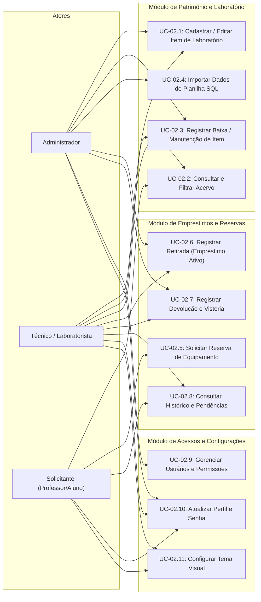

# Diagrama de Casos de Uso — UC-02: Gestão de Patrimônio e Empréstimos

Este documento mapeia os casos de uso centrais do GIPAR herdados da baseline e revisados para a evolução do sistema.

---

## 1. Visão Geral

Representa as funções administrativas, de controle patrimonial e operacionais exercidas por Técnicos, Administradores e Solicitantes.

## 2. Diagrama de Casos de Uso (Mermaid)

## 3. Rastreabilidade
- **Requisitos:** [[docs/01-requisitos/requisitos/REQ-002-responsividade-mobile|REQ-002]], [[docs/01-requisitos/requisitos/REQ-003-gestao-usuarios-temas|REQ-003]], [[docs/01-requisitos/requisitos/REQ-004-filtros-pesquisa-listagens|REQ-004]]
- **Regras de Negócio:** `RN-001` a `RN-007`
