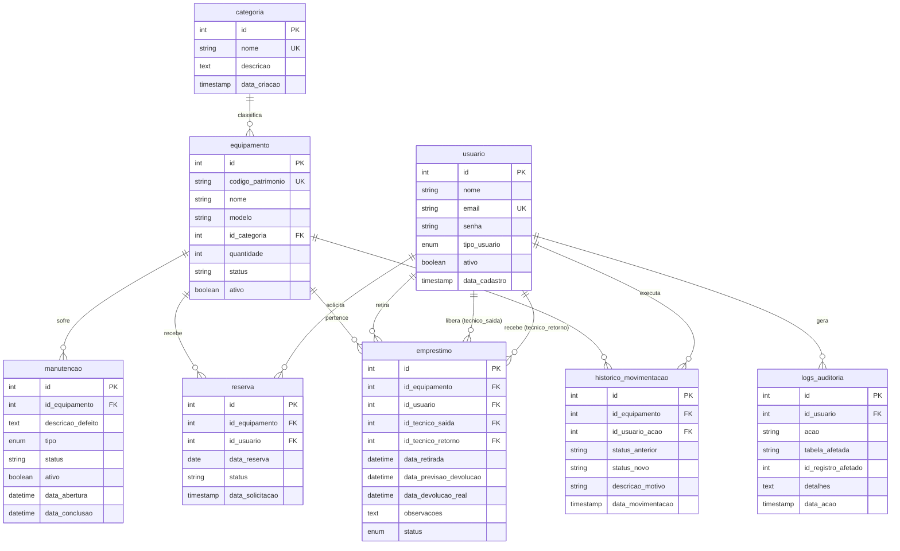

# Diagrama Entidade-Relacionamento (DER) — Modelo de Domínio GIPAR

Este documento formaliza o modelo relacional de banco de dados do GIPAR, mapeando as entidades, atributos, chaves primárias/estrangeiras e cardinalidades do MySQL.

---

## 1. Diagrama Entidade-Relacionamento (Mermaid)

---

## 2. Descrição das Entidades e Regras de Integridade

| Tabela | Responsabilidade de Negócio | Regra de Chave e Integridade |
| :--- | :--- | :--- |
| `categoria` | Agrupamento de itens (ex: Instrumentação, Componentes, Robótica). | `nome` é único (`UNIQUE`). |
| `usuario` | Cadastro de operadores e solicitantes com papéis de acesso. | `email` único, senha com hash. |
| `equipamento` | Cadastro físico do item/equipamento do laboratório. | `codigo_patrimonio` único; `id_categoria` obrigatório. |
| `manutencao` | Acompanhamento de defeitos, consertos e calibrações. | Vinculado a `equipamento`. |
| `reserva` | Agendamento prévio de item para data futura. | Validação de datas sem sobreposição. |
| `emprestimo` | Registro de saída, custódia e retorno físico de itens. | Registra técnico de entrega e recebimento. |
| `historico_movimentacao` | Trilha de auditoria das transições de status do item. | Chaves para `equipamento` e `usuario`. |
| `logs_auditoria` | Log de operações e auditoria de ações no sistema. | Rastreabilidade administrativa. |

## 3. Rastreabilidade
- **Arquivo-fonte DDL:** [`docker/mysql/init.sql`](file:///c:/Users/Luiz/Documents/BSI/TCC/Projeto/cepedi-capacita04-grupo3/docker/mysql/init.sql)
- **Regras de Negócio:** `RN-001`, `RN-002`, `RN-003`, `RN-004`, `RN-005`
- **Requisitos:** `REQ-001`, `REQ-004`
