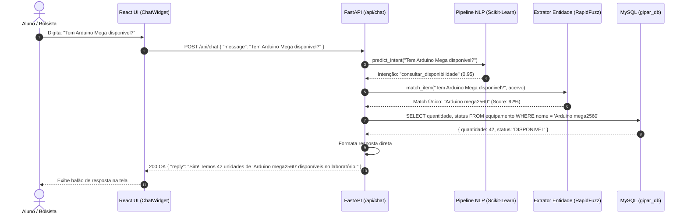
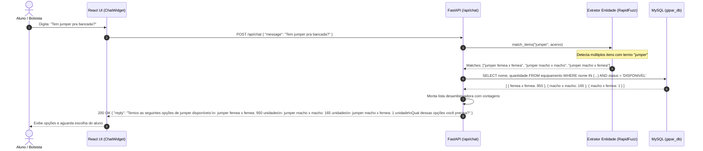
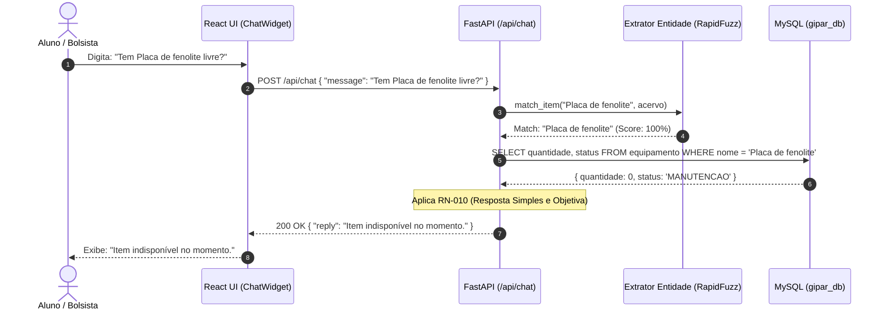
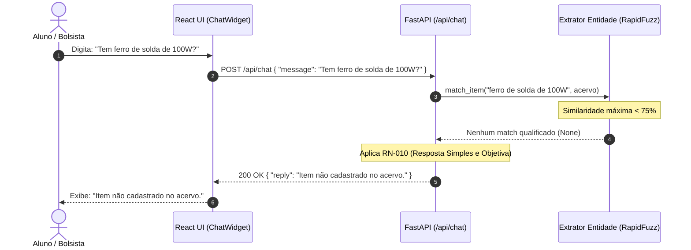

# Diagrama de Sequência — SEQ-01: Fluxos Conversacionais do Chatbot

Este documento detalha os fluxos temporais de troca de mensagens entre o Aluno, o componente de interface React, a API FastAPI, o pipeline NLP (Scikit-Learn + RapidFuzz) e o banco MySQL.

---

## 1. Fluxo Principal: Consulta de Item Específico

---

## 2. Fluxo de Desambiguação Proativa (Termo Genérico: Ex. "jumper")

---

## 3. Fluxo de Exceção: Item Indisponível (Esgotado / Em Manutenção)

---

## 4. Fluxo de Exceção: Item Não Cadastrado no Acervo

---

## 5. Rastreabilidade
- **Requisito:** [[docs/01-requisitos/requisitos/REQ-001-chatbot-atendimento|REQ-001]]
- **Regras de Negócio:** `RN-008`, `RN-009`, `RN-010`, `RN-011`
- **Diagrama de Casos de Uso:** [[docs/02-diagramas/casos-de-uso/UC-01-atendimento-chatbot|UC-01]]
