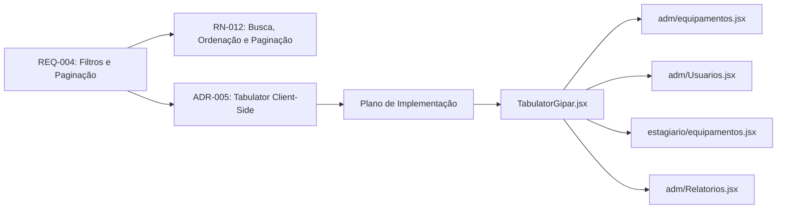

# Plano de Implementação — Listagens com Tabulator

> **Documento de Especificação e Planejamento Técnico**
>
> **Requisito Associado:** [REQ-004 — Filtros de Pesquisa Dinâmicos e Paginação nas Listagens](01-requisitos/requisitos/REQ-004-filtros-pesquisa-listagens.md)
>
> **Regra de Negócio Associada:** [RN-012 — Paginação, Ordenação e Busca em Listagens Tabulares](01-requisitos/regras-negocio.md#rn-012--paginação-ordenação-e-busca-global-em-listagens-tabulares)
>
> **Decisão de Arquitetura:** [ADR-005 — Padronização de Listagens com Tabulator Client-Side](03-adrs/ADR-005-datatable-listagens-client-side.md)
>
> **Data:** 12/10/2026
>
> **Status:** 🟡 Implementado — validação visual manual pendente

---

## 1. Objetivo

Adicionar paginação, ordenação e responsividade às listagens selecionadas utilizando **Tabulator 6.x** no frontend React 19.

A solução deve seguir a organização atual do projeto, reutilizar o componente `Pesquisa`, preservar os filtros já existentes e evitar alterações no backend. O novo componente será denominado **`TabulatorGipar`** e coexistirá com a atual `TabelaGipar`.

## 2. Princípios da Implementação

- manter o menor número possível de arquivos e alterações por página;
- integrar diretamente o pacote `tabulator-tables`, sem wrapper React adicional;
- manter busca e filtros nas páginas por meio do componente `Pesquisa`;
- delegar ao Tabulator somente tabela, ordenação, paginação e responsividade;
- processar os dados no navegador, sobre os arrays já retornados pela API;
- não alterar `TabelaGipar`, backend, endpoints ou consultas SQL;
- validar sem adicionar uma nova biblioteca de testes ao frontend.

## 3. Escopo

### 3.1 Telas incluídas

1. `frontend/src/pages/adm/equipamentos.jsx`;
2. `frontend/src/pages/adm/Usuarios.jsx`;
3. `frontend/src/pages/estagiario/equipamentos.jsx`;
4. `frontend/src/pages/adm/Relatorios.jsx`.

### 3.2 Fora do escopo

- `frontend/src/pages/estagiario/emprestimos.jsx`;
- `frontend/src/pages/adm/components/DashboardEmprestimos.jsx`;
- demais telas baseadas em cartões;
- alteração da `TabelaGipar` atual;
- paginação ou filtragem no backend;
- exportação de dados pelo Tabulator;
- edição direta nas células;
- testes automatizados de frontend nesta etapa.

## 4. Tecnologias e Responsabilidades

| Elemento | Responsabilidade |
| :--- | :--- |
| React 19 | ciclo de vida do componente e comunicação com as páginas |
| `tabulator-tables` 6.x | renderização, ordenação, paginação e layout responsivo |
| `Pesquisa` | termo textual e filtros de categoria, perfil ou status |
| Páginas | carregar dados, aplicar filtros e tratar ações de negócio |
| FastAPI | permanecer com os contratos atuais, sem alterações |

Não será utilizado `react-tabulator`. O pacote oficial será instanciado diretamente em um elemento referenciado por `useRef`. A criação e a destruição da instância ocorrerão em `useEffect`.

## 5. Estrutura Proposta

```text
frontend/src/components/tabulatorGipar/
├── TabulatorGipar.jsx
└── index.js

frontend/src/utils/
└── normalizarTexto.js
```

O CSS base do próprio Tabulator será importado pela aplicação conforme a forma compatível com o build atual.

## 6. Contrato Mínimo do Componente

```jsx
<TabulatorGipar
  colunas={colunas}
  dados={dadosFiltrados}
  onEditar={abrirEdicao}
  onDeletar={abrirExclusao}
/>
```

Propriedades previstas:

| Propriedade | Obrigatória | Finalidade |
| :--- | :---: | :--- |
| `colunas` | Sim | títulos, campos, ordenação, prioridade responsiva e formatadores |
| `dados` | Sim | registros já filtrados pela página |
| `onEditar` | Não | callback da ação de edição |
| `onDeletar` | Não | callback da ação de exclusão ou inativação |

O componente não receberá termo de busca, filtros extras ou estado de ordenação externo.

Configuração inicial prevista:

```javascript
{
  layout: "fitColumns",
  pagination: true,
  paginationMode: "local",
  paginationSize: 10,
  paginationSizeSelector: [10, 25, 50, 100],
  responsiveLayout: "collapse"
}
```

As colunas principais terão prioridade para permanecer visíveis. As colunas secundárias serão recolhidas pelo Tabulator em telas pequenas.

## 7. Tratamento de Dados e Atualizações

1. A página carrega os dados usando os serviços atuais.
2. O componente `Pesquisa` atualiza o termo e os filtros da página.
3. A página produz o array filtrado e o envia para `TabulatorGipar`.
4. O componente atualiza os dados da instância sem recriá-la desnecessariamente.
5. Ao receber um novo array filtrado, a paginação retorna à primeira página.
6. O Tabulator ordena e pagina localmente os dados recebidos.

A normalização de maiúsculas/minúsculas e acentuação permanecerá na lógica de filtro das páginas. Caso a mesma função comece a ser repetida, poderá ser extraída para um utilitário compartilhado durante a implementação, sem criar um hook de DataTable.

## 8. Roteiro de Implementação

### Etapa 1 — Dependência e componente base

1. adicionar `tabulator-tables` às dependências do frontend;
2. criar `TabulatorGipar.jsx` e `index.js`;
3. configurar criação, atualização e destruição da instância;
4. configurar paginação local, ordenação e `responsiveLayout: "collapse"`;
5. implementar os formatadores mínimos necessários para status e ações.

### Etapa 2 — Equipamentos do administrador

1. manter o componente `Pesquisa` e a lógica atual de filtros;
2. substituir apenas `TabelaGipar` por `TabulatorGipar`;
3. preservar os callbacks de edição e exclusão;
4. garantir busca sem distinção de caixa ou acentuação.

### Etapa 3 — Usuários

1. manter os filtros de perfil e status existentes;
2. substituir apenas o componente da tabela;
3. preservar edição e inativação de usuário.

### Etapa 4 — Equipamentos do estagiário

1. manter a busca e os filtros existentes;
2. substituir apenas o componente da tabela;
3. configurar prioridades responsivas das colunas.

### Etapa 5 — Relatórios

1. manter os filtros atuais de geração do relatório;
2. adicionar `Pesquisa` acima da pré-visualização, apenas com busca textual;
3. filtrar localmente os dados da pré-visualização;
4. substituir `TabelaGipar` por `TabulatorGipar`;
5. não alterar a exportação em PDF ou CSV.

## 9. Casos de Validação

| ID | Cenário | Resultado esperado |
| :--- | :--- | :--- |
| CT-01 | Digitar `fonte` na pesquisa | Exibir somente registros correspondentes e retornar à primeira página |
| CT-02 | Pesquisar `modulo`, `Módulo` e `MODULO` | Obter o mesmo conjunto de resultados |
| CT-03 | Clicar no cabeçalho de uma coluna principal | Alternar entre ordenação ascendente e descendente |
| CT-04 | Alterar o tamanho da página para 25 | Exibir até 25 registros e recalcular a paginação |
| CT-05 | Aplicar categoria, perfil ou status | Paginar somente o conjunto já filtrado pela página |
| CT-06 | Pesquisar um termo inexistente | Exibir o estado vazio sem erro de renderização |
| CT-07 | Editar ou excluir um registro | Executar o callback da linha correta sem disparos duplicados |
| CT-08 | Abrir em largura menor que 640 px | Recolher colunas secundárias e manter as principais acessíveis |
| CT-09 | Alterar o tipo de relatório | Atualizar dados e colunas da pré-visualização corretamente |
| CT-10 | Gerar e exportar relatório | Manter inalterados os fluxos existentes de PDF e CSV |
| CT-11 | Abrir as telas de empréstimos | Confirmar que continuam utilizando `TabelaGipar` sem regressão |

## 10. Validação Técnica

Após a implementação:

```powershell
cd frontend
npm run lint
npm run build
```

Além desses comandos, os casos CT-01 a CT-11 deverão ser executados manualmente em desktop e em viewport móvel. Não será adicionada dependência de testes automatizados nesta etapa.

## 11. Rastreabilidade



## 12. Estado da Implementação

Implementação concluída em 12/10/2026 com `tabulator-tables` 6.6.1:

- componente `TabulatorGipar` criado;
- quatro telas do escopo migradas;
- busca da pré-visualização de relatórios adicionada;
- normalização compartilhada de texto implementada;
- `TabelaGipar` e telas de empréstimos preservadas;
- build de produção executado com sucesso;
- lint direcionado aos arquivos novos executado com sucesso.

Permanece pendente a execução manual dos casos CT-01 a CT-11 em um ambiente com backend e frontend atualizados. O lint geral do frontend também continua bloqueado por erros preexistentes fora do escopo desta implementação.
