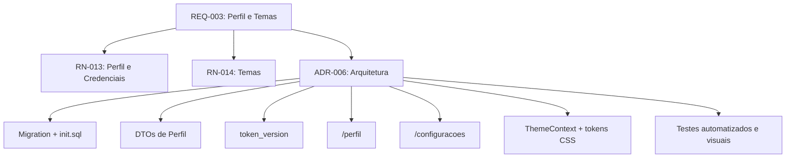

# Plano de Implementação — Meu Perfil, Avatares e Sistema de Temas

> **Documento de especificação e planejamento técnico**  
> **Requisito:** [REQ-003 — Gestão Avançada de Usuários, Meu Perfil e Sistema de Temas](01-requisitos/requisitos/REQ-003-gestao-usuarios-temas.md)  
> **Regras de negócio:** `RN-013` e `RN-014`  
> **Decisão arquitetural:** [ADR-006 — Arquitetura de Temas e Gestão de Perfil](03-adrs/ADR-006-arquitetura-temas-e-gestao-perfil.md)  
> **Data da revisão:** 15/10/2026  
> **Status:** 🟢 Planejamento aprovado — nenhuma implementação realizada neste documento

---

## 1. Objetivo

Implementar as telas protegidas **Meu Perfil (`/perfil`)** e **Configurações (`/configuracoes`)**, permitindo que qualquer usuário autenticado:

1. consulte e atualize seus próprios dados;
2. escolha um avatar de catálogo predefinido;
3. altere e-mail e senha com reautenticação e invalidação de JWTs anteriores;
4. selecione um dos quatro temas visuais;
5. mantenha sua preferência de tema em diferentes dispositivos.

O **Padrão Institucional GIPAR já existente não será redesenhado**. Ele será formalizado como tema padrão e fallback, mantendo sua aparência atual.

## 2. Escopo e Limites

### 2.1 Incluído

- Páginas `/perfil` e `/configuracoes`;
- Nome, nome de exibição, e-mail, avatar predefinido e senha;
- DTOs específicos para cada contrato;
- Política de senha com no mínimo 8 caracteres, contendo letras e números;
- Senha atual obrigatória para alterar senha ou e-mail;
- Invalidação dos JWTs anteriores por `token_version`;
- Catálogo fechado de avatares locais;
- Padrão Institucional GIPAR, Dark Mode, Ocean Blue e Alto Contraste;
- Persistência do tema no MySQL e cache local por usuário;
- Migration SQL versionada e atualização do DDL inicial;
- Testes de backend, integração, frontend e contraste.

### 2.2 Fora do escopo

- Upload de fotografias ou imagens do usuário;
- Armazenamento Base64 ou binário de avatar no MySQL;
- Coluna de avatar na listagem administrativa de usuários;
- Preferências sonoras, toast e persistência de notificações (`RN-007`);
- Correção de `/listar_usuarios`, mantida como lembrete de segurança ao final deste plano.

## 3. Decisões Funcionais

| Dimensão | Decisão | Justificativa |
| :--- | :--- | :--- |
| Navegação | Duas páginas: `/perfil` e `/configuracoes`. | Mantém a separação já apresentada pelo menu do usuário. |
| Avatar | Somente catálogo local predefinido. | Evita upload, volume de arquivos, validação de MIME e limpeza de imagens. |
| Exibição do avatar | Cabeçalho, menu e tela de perfil. | A listagem administrativa permanece objetiva e responsiva. |
| Campos editáveis | Nome, nome de exibição, e-mail e avatar. | Perfil de acesso e status permanecem protegidos. |
| Alteração de e-mail | Exige senha atual e força novo login. | O e-mail é a credencial utilizada na autenticação. |
| Alteração de senha | Senha atual, nova senha e confirmação; mínimo de 8 caracteres com letras e números. | Mantém a política já documentada. |
| Invalidação | Incremento de `token_version` ao mudar e-mail ou senha. | Invalida tokens antigos em todos os dispositivos sem blacklist. |
| Temas | Institucional preservado mais Dark, Ocean e Alto Contraste na mesma entrega. | Atende ao catálogo aprovado sem modificar o visual padrão. |
| Persistência do tema | MySQL como fonte oficial e `localStorage` como cache por usuário. | A preferência acompanha o usuário entre dispositivos e evita atraso visual. |
| Acessibilidade | Contraste medido antes de declarar conformidade WCAG. | Evita afirmações sem evidência objetiva. |

## 4. Comportamento das Telas

### 4.1 Meu Perfil (`/perfil`)

```text
+--------------------------------------------------------------------------------+
| MEU PERFIL                                                                     |
+--------------------------+-----------------------------------------------------+
| AVATAR                   | DADOS PESSOAIS                                      |
|                          | Nome completo      [..............................]  |
| [ Avatar atual ]         | Nome de exibição  [..............................]  |
|                          | E-mail             [..............................]  |
| [Escolher avatar]        | Perfil             [ADMINISTRADOR] somente leitura |
|                          | Membro desde       dd/mm/aaaa                       |
|                          |                                                     |
|                          | Se alterar o e-mail, informe a senha atual porque   |
|                          | ele é sua credencial de login. Você precisará       |
|                          | entrar novamente.                                   |
|                          | Senha atual       [**************]                  |
|                          |                         [Salvar alterações]          |
+--------------------------+-----------------------------------------------------+
| SEGURANÇA                                                                      |
| Senha atual          [**************]                                           |
| Nova senha           [**************]  Mínimo 8, com letras e números           |
| Confirmar nova senha [**************]                                           |
| Após a alteração, todas as sessões anteriores serão invalidadas.               |
|                                                     [Atualizar senha]           |
+--------------------------------------------------------------------------------+
```

Regras de interação:

- `senha_atual` no formulário de dados só é obrigatória se o e-mail mudar;
- alterar apenas nome, nome de exibição ou avatar não encerra a sessão;
- alterar e-mail ou senha invalida os tokens anteriores e redireciona para `/login`;
- o perfil de acesso é somente leitura;
- o avatar não escolhido utiliza a inicial do nome como fallback;
- após atualização sem troca de credencial, cabeçalho e sessão local refletem os novos dados.

### 4.2 Configurações (`/configuracoes`)

```text
+--------------------------------------------------------------------------------+
| CONFIGURAÇÕES                                                                  |
+--------------------------------------------------------------------------------+
| APARÊNCIA                                                                      |
| [Padrão Institucional] [Dark Mode] [Ocean Blue] [Alto Contraste]               |
|                                                                                |
| O tema institucional mantém o visual atual do GIPAR.                           |
+--------------------------------------------------------------------------------+
| SOBRE O SISTEMA                                                                |
| Nome e informações da instalação obtidos de configuração versionada.           |
+--------------------------------------------------------------------------------+
```

Regras de interação:

- selecionar um card aplica o tema imediatamente;
- a preferência só é considerada confirmada após resposta bem-sucedida da API;
- em caso de falha, a tela informa o erro e retorna ao último tema confirmado;
- o cache utiliza chave por usuário, por exemplo `gipar_tema_12`;
- depois do login, o valor retornado pelo MySQL prevalece sobre o cache;
- antes da autenticação, o fallback é o Padrão Institucional GIPAR.

## 5. Banco de Dados e Migration

### 5.1 Estrutura pretendida

```sql
ALTER TABLE usuario
    ADD COLUMN nome_exibicao VARCHAR(100) NULL AFTER nome,
    ADD COLUMN avatar VARCHAR(50) NULL AFTER nome_exibicao,
    ADD COLUMN tema VARCHAR(30) NOT NULL DEFAULT 'padrao' AFTER ativo,
    ADD COLUMN token_version INT NOT NULL DEFAULT 0 AFTER tema;
```

Valores aceitos de tema:

- `padrao`;
- `dark`;
- `ocean`;
- `alto_contraste`.

O catálogo de avatar será validado pela aplicação. O banco armazenará somente a chave, por exemplo `robo_azul`, sem caminho absoluto ou conteúdo da imagem.

### 5.2 Estratégia de evolução

1. Atualizar `docker/mysql/init.sql` para instalações novas;
2. Criar `docker/mysql/migrations/001_perfil_temas_token_version.sql` para bancos existentes;
3. Tornar a migration segura para execução controlada e documentar pré-condições;
4. Aplicar a migration no MySQL containerizado sem apagar o volume;
5. Verificar colunas, defaults e preservação dos usuários existentes;
6. Registrar o procedimento de rollback compatível com o ambiente de desenvolvimento.

O projeto ainda não possui executor automático de migrations. Nesta entrega, o arquivo SQL será versionado e sua aplicação será explícita e documentada.

## 6. Contratos Pydantic

Os nomes abaixo são orientativos, mas a separação de responsabilidades é obrigatória.

### 6.1 `PerfilUsuarioResponse`

Campos:

- `id`;
- `nome`;
- `nome_exibicao`;
- `email`;
- `tipo_usuario`;
- `avatar`;
- `tema`;
- `data_cadastro`.

Nunca deve retornar senha, hash, `token_version` ou dados de outro usuário.

### 6.2 `AtualizarPerfilRequest`

Campos:

- `nome`;
- `nome_exibicao`;
- `email`;
- `avatar`;
- `senha_atual`, opcional quando o e-mail não muda e obrigatória quando muda.

Não aceita `id`, `tipo_usuario`, `ativo`, `tema` ou senha nova.

### 6.3 `AlterarSenhaRequest`

Campos:

- `senha_atual`;
- `nova_senha`;
- `confirmacao_senha`.

Validações:

- mínimo de 8 caracteres;
- pelo menos uma letra;
- pelo menos um número;
- confirmação idêntica;
- nova senha diferente da senha atual.

### 6.4 `AtualizarTemaRequest`

Campo único:

- `tema`, validado por enum/allowlist.

## 7. Backend FastAPI

### 7.1 Rotas internas e exposição externa

| FastAPI | URL pelo frontend | Responsabilidade |
| :--- | :--- | :--- |
| `GET /usuarios/me` | `GET /api/usuarios/me` | Consultar o próprio perfil. |
| `PUT /usuarios/me` | `PUT /api/usuarios/me` | Atualizar dados e, opcionalmente, e-mail. |
| `PUT /usuarios/me/senha` | `PUT /api/usuarios/me/senha` | Alterar senha e invalidar tokens anteriores. |
| `PATCH /usuarios/me/tema` | `PATCH /api/usuarios/me/tema` | Persistir o tema selecionado. |

Todas as rotas usam o ID extraído do JWT. Nenhuma aceita ID de usuário no corpo ou na URL.

### 7.2 Fluxo de autenticação e `token_version`

1. O login consulta `token_version` junto com os demais dados do usuário;
2. O JWT recebe a claim `token_version`;
3. A dependência de autenticação decodifica o JWT e consulta `id`, `ativo` e `token_version` no banco;
4. Token de usuário inexistente/inativo ou com versão divergente recebe `401`;
5. Alterar e-mail ou senha incrementa `token_version` na mesma transação da alteração;
6. A resposta informa que a reautenticação é obrigatória;
7. O frontend remove a sessão e navega para `/login`.

### 7.3 Atualização de perfil

- Buscar o registro pelo ID autenticado;
- Normalizar e validar nome e e-mail;
- Validar avatar contra catálogo permitido;
- Se o e-mail não mudou, ignorar `senha_atual` e manter `token_version`;
- Se o e-mail mudou, validar senha atual e unicidade, atualizar o e-mail e incrementar `token_version` atomicamente;
- Retornar `409 Conflict` para e-mail duplicado;
- Registrar alteração relevante na auditoria, sem incluir senha ou hash.

### 7.4 Alteração de senha

- Validar senha atual com `argon2`;
- Aplicar a política de senha no DTO e no serviço;
- Gerar o novo hash;
- Atualizar hash e incrementar `token_version` na mesma transação;
- Nunca registrar senha, confirmação ou hash em logs/auditoria.

## 8. Frontend React

### 8.1 Estrutura prevista

```text
frontend/src/
├── assets/avatares/
├── contexts/
│   └── ThemeContext.jsx
├── pages/
│   ├── perfil/MeuPerfil.jsx
│   └── configuracoes/Configuracoes.jsx
├── services/
│   └── perfil/perfil.service.js
├── styles/
│   └── themes.css
└── components/
    └── ui/Avatar/Avatar.jsx
```

### 8.2 Integração de autenticação

- Adicionar ao `AuthContext` uma operação para atualizar os dados locais após edição sem troca de credencial;
- Atualizar `sessionStorage` quando nome, nome de exibição ou avatar mudar;
- Encerrar a sessão após alteração de e-mail ou senha;
- Tratar `401` centralmente para tokens invalidados;
- Não incluir hash, senha atual ou `token_version` na sessão do navegador.

### 8.3 Rotas e permissões

- Registrar `/perfil` e `/configuracoes` no `App.jsx` com `ProtectedRoute`;
- Incluir as duas rotas em todos os conjuntos de `ROTAS_POR_PERFIL`;
- Trocar os alertas temporários do cabeçalho por navegação com React Router;
- Manter o perfil de acesso como badge somente leitura.

### 8.4 Catálogo de avatares

- Usar chaves estáveis e uma allowlist compartilhada pelo contrato da aplicação;
- Exibir catálogo responsivo com nome acessível para cada opção;
- Atualizar `Avatar` para aceitar a chave do avatar e manter fallback por inicial;
- Exibir avatar somente em perfil, menu e cabeçalho;
- Não adicionar avatar às colunas da listagem administrativa.

### 8.5 Motor de temas

1. Catalogar as cores atualmente utilizadas pelo Padrão Institucional GIPAR;
2. Criar tokens semânticos para fundos, superfícies, textos, bordas, destaque, foco e estados;
3. Mapear o tema `padrao` para os valores atuais, sem mudança visual;
4. Migrar os componentes que possuem cores fixas para esses tokens;
5. Implementar `dark`, `ocean` e `alto_contraste` na mesma entrega;
6. Aplicar `data-theme` no elemento raiz;
7. Inicializar a partir do cache por usuário quando houver sessão;
8. Reconciliar com o valor do banco retornado pelo perfil;
9. Persistir alterações por `PATCH /api/usuarios/me/tema`;
10. Medir contraste de textos, controles, foco, badges e estados nos quatro temas.

## 9. Sequência de Implementação

### Etapa 0 — Caracterização

1. Criar testes dos contratos atuais de login, sessão e usuário;
2. Registrar visualmente o Padrão Institucional GIPAR como baseline;
3. Inventariar componentes com cores fixas;
4. Confirmar o catálogo e as chaves dos avatares.

### Etapa 1 — Banco

1. Criar migration versionada;
2. Atualizar `init.sql`;
3. Validar migration em volume MySQL existente;
4. Validar inicialização de banco novo.

### Etapa 2 — DTOs, autenticação e repositório

1. Criar os quatro DTOs;
2. Implementar consulta e atualização do próprio perfil;
3. Adicionar `token_version` ao login e à validação JWT;
4. Implementar alteração de e-mail e senha com transação;
5. Implementar persistência do tema;
6. Adicionar auditoria sem dados sensíveis.

### Etapa 3 — Rotas e testes de backend

1. Criar as quatro rotas autenticadas;
2. Testar usuário inexistente/inativo e token desatualizado;
3. Testar DTOs contra tentativa de alterar `tipo_usuario` e `ativo`;
4. Testar e-mail duplicado, senha incorreta e política de senha;
5. Confirmar que tokens anteriores falham após alteração de e-mail ou senha.

### Etapa 4 — Meu Perfil e avatar

1. Criar serviço de perfil;
2. Construir a página `/perfil`;
3. Integrar o catálogo de avatares;
4. Atualizar sessão e cabeçalho após edições comuns;
5. Exibir a explicação da senha atual na alteração de e-mail;
6. Encerrar a sessão após alteração de credencial.

### Etapa 5 — Arquitetura e catálogo de temas

1. Criar tokens semânticos e o `ThemeContext`;
2. Preservar visualmente o Padrão Institucional;
3. Migrar componentes com cores fixas;
4. Implementar os três temas adicionais;
5. Criar a página `/configuracoes`;
6. Integrar persistência no banco e cache por usuário.

### Etapa 6 — Navegação e validação final

1. Ativar os itens do menu;
2. Registrar rotas e permissões para todos os perfis;
3. Validar responsividade;
4. Executar testes automatizados;
5. Medir contraste e documentar resultados;
6. Confirmar que o padrão institucional não sofreu regressão visual.

## 10. Casos de Teste

| ID | Cenário | Resultado esperado |
| :--- | :--- | :--- |
| CT-01 | Acessar Meu Perfil pelo menu | Abre `/perfil` com dados do usuário autenticado. |
| CT-02 | Enviar `tipo_usuario` ou `ativo` no DTO de perfil | Campo rejeitado ou ignorado conforme política explícita, sem alteração no banco. |
| CT-03 | Alterar nome, nome de exibição ou avatar | Banco, sessão e cabeçalho são atualizados sem logout. |
| CT-04 | Selecionar avatar inexistente | Backend rejeita a chave. |
| CT-05 | Alterar e-mail sem senha atual | Backend rejeita e a tela explica o motivo. |
| CT-06 | Alterar e-mail com senha incorreta | Backend rejeita sem alterar e-mail ou versão do token. |
| CT-07 | Alterar e-mail para endereço duplicado | Backend responde `409 Conflict`. |
| CT-08 | Alterar e-mail com dados válidos | E-mail muda, `token_version` aumenta e novo login é exigido. |
| CT-09 | Nova senha com menos de 8 caracteres ou sem letra/número | DTO rejeita a requisição. |
| CT-10 | Trocar senha com senha atual incorreta | Backend rejeita sem alterar hash ou `token_version`. |
| CT-11 | Trocar senha corretamente | Hash e versão mudam; sessão local termina. |
| CT-12 | Reutilizar JWT emitido antes da troca de e-mail/senha | Backend responde `401`. |
| CT-13 | Alternar entre os quatro temas | Interface muda sem recarregar e mantém legibilidade. |
| CT-14 | Entrar em outro dispositivo | Tema salvo no MySQL é aplicado. |
| CT-15 | Dois usuários utilizarem o mesmo navegador | Cada usuário utiliza sua própria chave de cache. |
| CT-16 | Falhar a persistência do tema | Interface informa falha e restaura o último tema confirmado. |
| CT-17 | Selecionar Padrão Institucional | Aparência permanece equivalente à baseline atual. |
| CT-18 | Medir contraste dos quatro temas | Resultados registrados; nenhuma conformidade é declarada sem evidência. |
| CT-19 | Aplicar migration em banco existente | Dados atuais permanecem íntegros e novas colunas recebem defaults corretos. |
| CT-20 | Inicializar banco novo | `init.sql` cria a tabela com o schema atualizado. |

## 11. Critérios de Conclusão

- Migration e `init.sql` validados;
- DTOs impedem exposição de senha e alteração de privilégios;
- E-mail e senha seguem a política definida e invalidam JWTs anteriores;
- Perfil e avatar atualizam cabeçalho e sessão corretamente;
- Rotas funcionam para todos os perfis autenticados;
- Padrão Institucional não apresenta regressão visual;
- Três temas alternativos funcionam em toda a interface;
- Preferência acompanha o usuário entre dispositivos;
- Responsividade, contraste e estados de erro foram testados;
- Documentação, requisito, regras e ADR permanecem rastreáveis.

## 12. Rastreabilidade



## 13. Pendência de Segurança Posterior

Ao concluir esta implementação, abrir tarefa separada para:

- proteger `/listar_usuarios` com a permissão adequada;
- remover senhas de demonstração da resposta;
- garantir que nenhuma resposta ou log exponha senha, hash ou token;
- criar testes de regressão específicos para essa rota.

Essa pendência é crítica, mas não faz parte do escopo de implementação do `REQ-003`.
